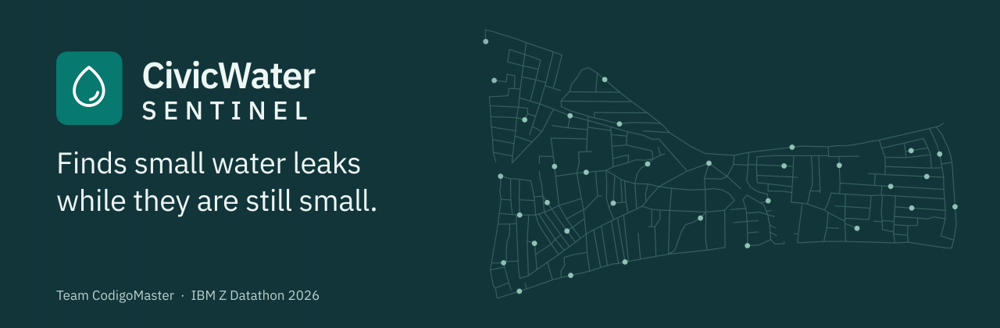
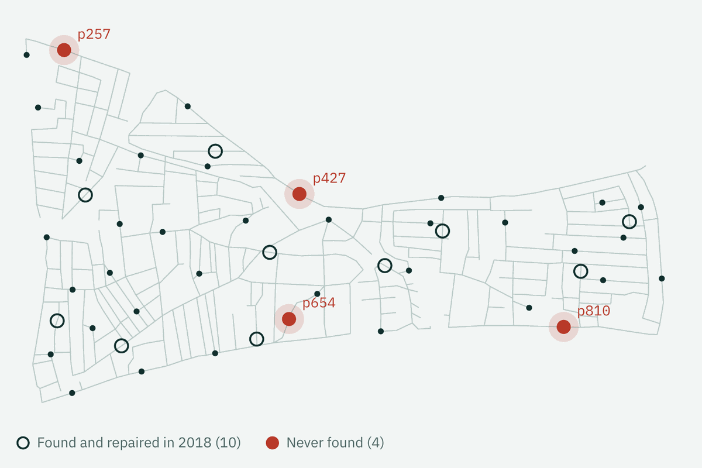
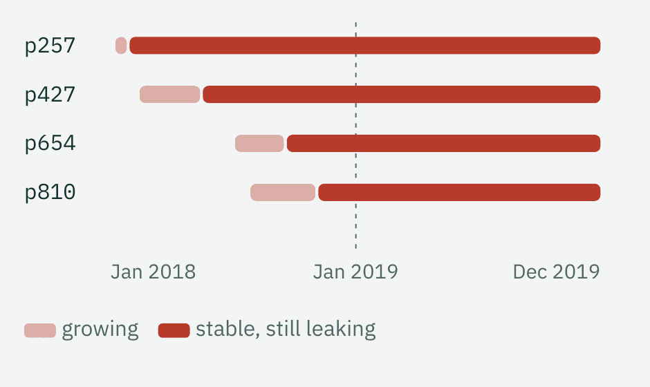
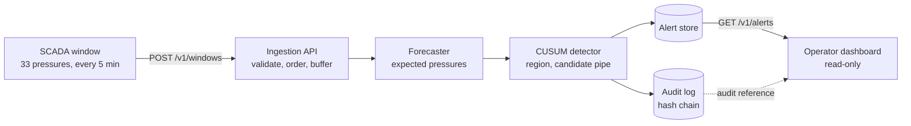
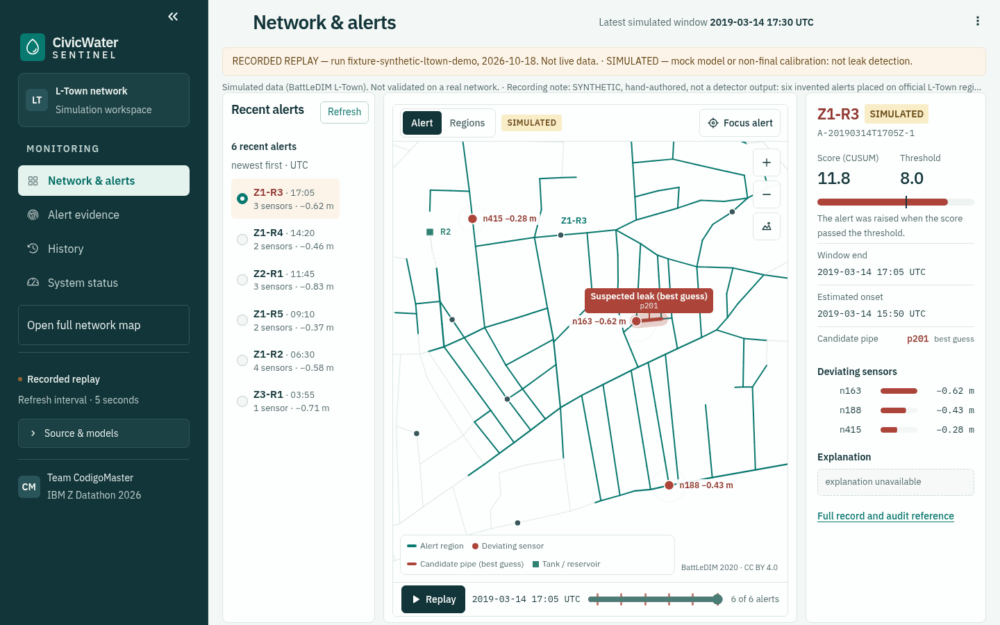
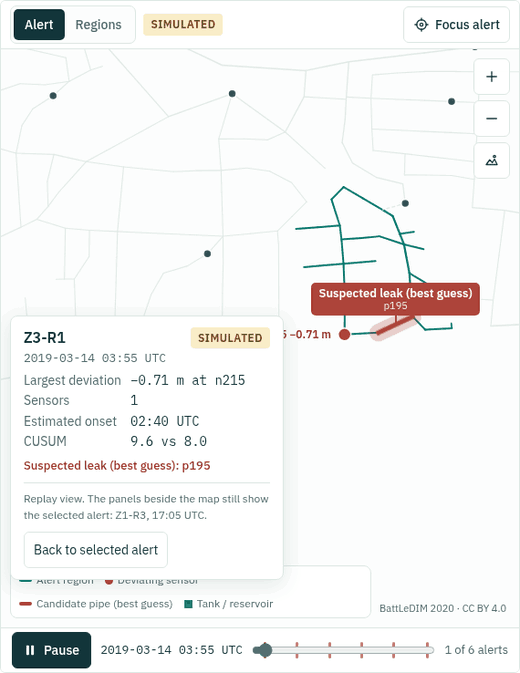
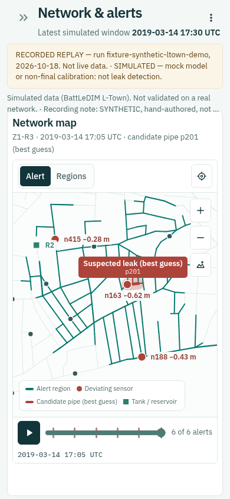
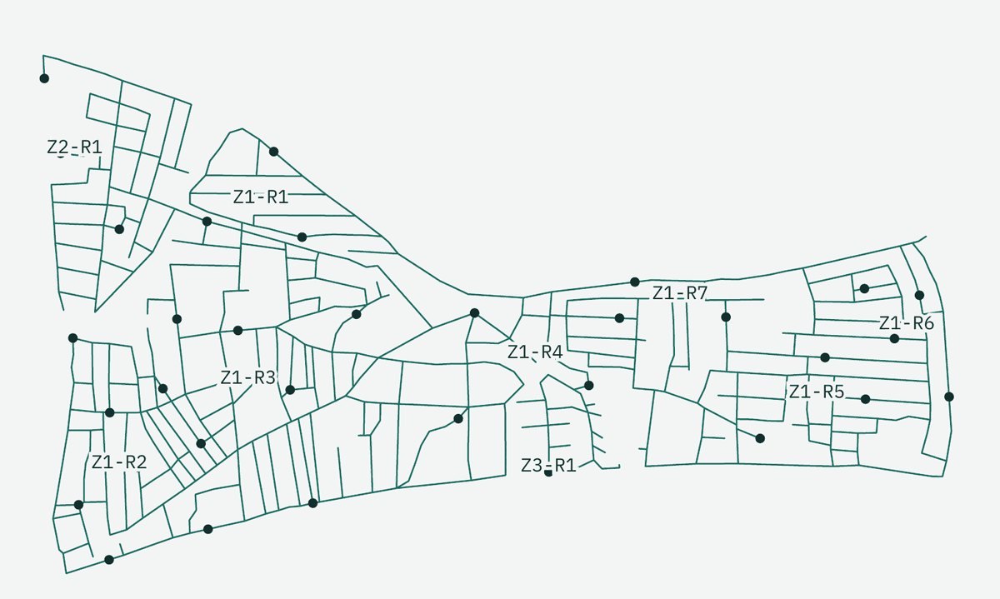
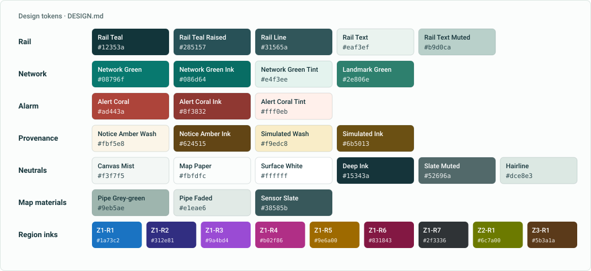

<p align="center">
  
</p>

<p align="center">
  <a href="https://github.com/pedruck/Team-CodigoMaster_IBM-Z-Datathon-2026---Civic-Water-Sentinal/actions/workflows/ci.yml"></a>
  &nbsp;·&nbsp; Python 3.12 &nbsp;·&nbsp; IBM LinuxONE (s390x) &nbsp;·&nbsp; MIT
</p>

**CivicWater Sentinel** scores the pressure readings of a water network every five minutes and
raises a *suspected-leak* alert that says **where to look and why**: a region, the sensors that
drifted, a candidate pipe (always a best guess) and an audit record behind it. It runs on IBM
LinuxONE. Built by Team CodigoMaster for the IBM Z Datathon 2026.

> **Simulated data.** Everything here runs on the BattLeDIM L-Town benchmark, a *simulated*
> network. Nothing is validated on a real utility, and whatever comes from a mock or a non-final
> calibration is labelled **SIMULATED** and is never presented as leak detection.

[The problem](#the-problem) · [How it works](#how-it-works) · [Demo](#demo) ·
[Status](#what-is-real-and-what-is-simulated) · [Quick start](#quick-start) ·
[Dashboard](#the-operator-dashboard) · [Documentation](#documentation) · [Team](#team)

This repository holds the **backend** (ingestion API and orchestration of forecaster, detector and
audit) and the **operator dashboard**. The models are owned by other team members and plug in
through stable interfaces.

## The problem

**Small leaks run for months before anyone notices.** In the simulated 2018 of the BattLeDIM
benchmark the utility found and repaired 10 leaks. Four small ones were never found and kept
leaking through all of 2019.

<table>
<tr>
<td width="62%"></td>
<td width="38%"></td>
</tr>
</table>

<sub>The four leaks never found in 2018 (`p257`, `p427`, `p654`, `p810`) and how long they ran.
Figures from the team pitch; network from BattLeDIM 2020 (Vrachimis et al.), CC BY 4.0.</sub>

The data to catch them exists (33 pressure sensors, one reading every 5 minutes: **9,504 readings a
day**) but nobody can watch all of it. A slow leak is a small, steady pressure drop buried in the
normal swings of daily demand, and every alarm sends a crew out: false ones waste time and teach
operators to ignore the next. Operators need to know *which part of the network*, *why it was
flagged* and *a record of what was decided*.

## How it works

Every 5 minutes, Sentinel checks whether each sensor reads lower than it should.

| | Step | What happens |
|---|---|---|
| 1 | **Expect** | An XGBoost forecaster (one model per pressure sensor) predicts what all 33 pressures should read, from the inlet flows, the tank level, the time of day and the neighbouring sensors. Served with IBM Snap ML. |
| 2 | **Compare** | Observed minus expected pressure is the signal; normal demand cancels out. |
| 3 | **Accumulate** | A CUSUM adds up small drops that keep repeating, so a slow leak crosses the threshold and a single spike does not. |
| 4 | **Explain** | The alert names a network region and a candidate pipe. A narrator (IBM Granite) can write a short note: where, since when, which sensors moved. |



Ingestion, forecasting, detection and the audit log run on IBM LinuxONE. Model training happens
off-platform on 2018 data, 2019 is replayed as a live stream, and the dashboard reads the API from a
laptop through an SSH tunnel (or from a read-only gateway, BE-026). Components, ownership and the
data flow of one window: [`docs/architecture.md`](docs/architecture.md).

## Demo

### The operator workspace

<p align="center">
  
</p>

<sub>A recorded replay of a **synthetic, hand-authored** fixture
(`fixture-synthetic-ltown-demo`): six invented alerts placed on official L-Town region, sensor and
pipe IDs. Not a detector output; the RECORDED REPLAY and SIMULATED banners stay on screen.</sub>

<table>
<tr>
<td align="center"></td>
<td align="center"></td>
</tr>
<tr>
<td align="center"><sub>The in-map replay walks the day's alerts in time order.</sub></td>
<td align="center"><sub>Phone width: panes stack, map first.</sub></td>
</tr>
</table>

More captures (Regions mode, replay card, evidence, history, 200 % text):
[`docs/dashboard-design.md`](docs/dashboard-design.md).

### Run it yourself

The recorded fixture needs no backend and no network once installed:

```bash
uv sync --locked --group dashboard
just dashboard-playback dashboard/playback/fixture-synthetic-ltown-demo
# open http://localhost:8501
```

Streamlit listens on all interfaces by default. On a shared network, bind it to the loopback
address instead:

```bash
SENTINEL_DASHBOARD_PLAYBACK_DIR=dashboard/playback/fixture-synthetic-ltown-demo PYTHONPATH=. \
  uv run --group dashboard streamlit run dashboard/app.py --server.address 127.0.0.1
```

To read a live backend instead, start it (`just dev`), feed it ([Quick start](#quick-start)) and run
`just dashboard http://127.0.0.1:8000`. The timed five-minute demo script, with what to say for
each banner and the fallbacks, is [`docs/demo-runbook.md`](docs/demo-runbook.md).

### L-Town, region by region

<p align="center">
  
</p>

<sub>The 9 detection regions over the 33 pressure sensors. Regions come from the pipes alone: zones
split by the pump and the pressure valves, sensors grouped by distance along the pipes, fixed
before any evaluation ([ADR-011](docs/adr/ADR-011-pipe-network-regions-candidate-pipe.md)).</sub>

An alert points to a region and a **candidate pipe**: the pipe that best matches the sensors that
drifted, measured along the network. It is a best guess, not a confirmed leak. A development check
on 2018, **not a final result**: for 5 of 6 abrupt leaks the first candidate pipe was within about
360 m of the real one.

### By the numbers

Figures come from the team pitch and were checked against the documents named in the last column.
All of them are on the **simulated** L-Town network.

| | Measure | Value | Source |
|---|---|---|---|
| **Data** | Pressure sensors, readings per day | 33 sensors, one per 5 minutes: 9,504 a day | [`docs/data.md`](docs/data.md) |
| | Labelled leaks in 2018 | 14 (6 abrupt, 8 incipient); 10 repaired, 4 never repaired | [ADR-007](docs/adr/ADR-007-cusum-detector.md) |
| | Official leaks in 2019 | 23; read only by the final evaluation, never by a model | [ADR-010](docs/adr/ADR-010-layer2-evaluation.md) |
| **Models** | Forecast error on normal windows (validation Nov to Dec 2018) | baseline 105 mm, GRU 77 mm, **XGBoost 6 mm** (served) | [`docs/p2-forecasting.md`](docs/p2-forecasting.md) |
| | Leak contrast (pressure-drop score, leak vs normal periods) | 3.4 × for XGBoost; compares means, not false alarms or delay | [`docs/p2-forecasting.md`](docs/p2-forecasting.md) |
| | Detection on 2018 out-of-fold residuals, 1 false alarm a week | 8 of 14 leaks (abrupt 6 of 6, median delay 4.4 h); incipient leaks are at chance level. Development calibration; the budget awaits the team (Q-TEAM-03) | [`docs/p4-calibration.md`](docs/p4-calibration.md) |
| **Platform** | 2019 replayed over HTTP on the s390x VM, real forecaster | 105,120 windows, 0 errors, 425.6 windows/s (about 128,000 × real time), pipeline median 0.94 ms; mock detector | [`docs/performance.md`](docs/performance.md) |
| | Same replay, full stack (CUSUM v1 + audit chain) | 301.7 windows/s, 106,015 audit records, chain verified | [`docs/performance.md`](docs/performance.md) |
| | One forecast with Snap ML | 0.64 ms on the CPU; the Telum accelerator measured 1.35 ms for trees this small, so the faster path is served | [`docs/p2-forecasting.md`](docs/p2-forecasting.md) |

One run on a shared VM is not a benchmark, and no figure above is a 2019 detection score.

## What is real and what is simulated

| Component | State |
|---|---|
| Ingestion API | **Working**: validation, ordering, gap handling, idempotent resend, physical limits, optional write token. |
| Forecaster | **Real XGBoost available** (`SENTINEL_FORECASTER=xgboost` plus the model artefact, loaded once at startup). The default is `mock`. |
| Detector | **CUSUM with a committed calibration** ([`config/calibration.xgboost-33.json`](config/calibration.xgboost-33.json), out-of-fold 2018 residuals) that makes `is_mock` false for the served `xgboost-33@0.1.0`. The default is `mock`. The operating budget is still open to the team. |
| Regions, candidate pipe | **Working.** Nine regions are committed; the pipe network is the data owner's file, kept outside git. |
| Audit | **Hash chain selectable** (`SENTINEL_AUDIT_SINK=chain`), with stored explanations and read endpoints. The default sink is `null`. |
| Dashboard | **Working** on the live API or a recorded run, public at https://civicwater-sentinel-dashboard.onrender.com (BE-028). The **Sentinel assistant** explains the network and each alert as a chat, with the audited text attached (BE-029). |
| 2019 evaluation | **Not run yet.** Nothing in this repository is a score against the 23 official 2019 leaks. |
| Recorded real run | **None yet.** The demo above is a synthetic fixture. |

Day-to-day state, blockers and verification: [`docs/status.md`](docs/status.md).

## Quick start

Requirements: Python 3.12, [uv](https://docs.astral.sh/uv/), [just](https://just.systems/).

```bash
uv sync --locked
just check        # format, lint, typecheck (mypy strict), tests
just dev          # http://127.0.0.1:8000/docs
```

Send one window (the example matches the provisional registry):

```bash
curl -s -X POST localhost:8000/v1/windows -H 'content-type: application/json' -d @docs/examples/window.valid.json
```

Replay a synthetic day (invented signal, step drop at window 200). Windows must be newer than
the last accepted one, so start from a fresh server (state is in memory) if you already sent
the example above, which is dated 2019-03-14:

```bash
uv run python scripts/make_synthetic.py data/synthetic.jsonl --count 288 --leak-at 200
```

```bash
just replay data/synthetic.jsonl
```

`just --list` shows every command. Configuration of the real forecaster, the CUSUM detector and
the audit chain: [`docs/configuration.md`](docs/configuration.md).

## API

| Method | Path | Purpose |
|---|---|---|
| GET | `/health` | liveness |
| POST | `/v1/windows` | ingest one window (201 new, 200 idempotent resend, 409 order/conflict, 422 invalid) |
| GET | `/v1/status` | history, models (`mocks_active`), registry, counters, latency p50/p95/p99, throughput, error rate |
| GET | `/v1/alerts` | alerts, newest first; `limit`, `offset`, `since`, `until`, `region` |
| GET | `/v1/alerts/{alert_id}` | one alert |
| GET | `/v1/alerts/{alert_id}/explanation` | stored explanation of the alert (`pending` / `ready`); needs the audit chain |
| GET | `/v1/audit` | audit records exactly as stored, `after_seq`, `limit`; needs the audit chain |
| GET | `/v1/audit/head` | `{seq, hash}` of the last audit record (the anchor to keep outside the VM) |

Contracts: [`docs/integration-contracts.md`](docs/integration-contracts.md); OpenAPI at `/docs`.
State is **in memory** and lost on restart (ADR-003); run a single worker.

## The operator dashboard

A read-only workspace for a water-utility operator: *show where to look, and prove why.* The first
screen is three panes (the alert queue, the live L-Town map, the evidence of the selected alert)
and every received value stays inspectable. The full design system is [`DESIGN.md`](DESIGN.md), the
product brief is [`PRODUCT.md`](PRODUCT.md).

<picture>
  <source media="(prefers-color-scheme: dark)" srcset="docs/images/brand/logo-dark.svg">
  
</picture>

**The network is the workspace.** A light, quiet operations room around one live object, the L-Town
schematic. A dark teal rail frames a misty canvas; flat white panes sit on it, separated by 1 px
hairlines rather than shadows. The network carries the colour, and each colour has one job:

<p align="center">
  
</p>

| Rule | In practice |
|---|---|
| **Coral is an alarm** | Only deviating sensors, the candidate pipe and alert scores use it. Never for branding, links or decoration. |
| **Amber means provenance** | SIMULATED and RECORDED REPLAY notices. It never signals severity and never disappears while the condition holds. |
| **Green means network** | Location and interaction: the alert region, focus rings, selection. It is not a success state. |
| **Uncertainty is visible** | "best guess" beside every candidate pipe; the assistant says when a source has no stored explanation and labels language-model text; nothing is styled "verified" or "confirmed". |
| **Received values are mono** | Times, IDs, deviations and scores in IBM Plex Mono with tabular numerals; prose in IBM Plex Sans, sentence case. |
| **Hairline, not shadow** | Flat panes with 1 px borders and 8 / 6 / 4 px radii. Only panels floating over the map earn a shadow. |

- **Layout.** Queue (220 px), map (the rest), evidence (260 px) in the first viewport; the panes
  stack map, queue, evidence on narrow screens. The map zooms, pans, isolates the nine regions,
  flies to the alert and replays the day.
- **Motion.** A camera flight and a pulse move the eye to the alert; entrance reveals use GSAP.
  Everything is gated by `prefers-reduced-motion`.
- **Accessibility.** Keyboard operable, 44 px targets, WCAG AA contrast, no horizontal scroll from
  360 to 1920 px, readable with text enlarged to 200 %. Measured in Chrome, not a full audit:
  [`docs/dashboard-ux-review.md`](docs/dashboard-ux-review.md).
- **Offline.** IBM Plex, Phosphor icons and GSAP are bundled in
  [`dashboard/assets/`](dashboard/assets/README.md): no CDN, no Node build.

The logo is the dashboard's own brand lockup (a Phosphor drop on a Network Green tile and the IBM
Plex wordmark) redrawn as outlines; see [`docs/images/brand/`](docs/images/brand/README.md).

| Source of the dashboard | How to run | Notes |
|---|---|---|
| Recorded run | `just dashboard-playback <run-dir>` | Any run in the standard format; always shows RECORDED REPLAY. |
| Live API | `just dashboard http://127.0.0.1:8000` | Through an SSH tunnel for the VM ([`docs/demo-runbook.md`](docs/demo-runbook.md)). |
| Off the VM | gateway or snapshots | Read-only; code done, VM checks `NOT_RUN` ([`docs/external-dashboard.md`](docs/external-dashboard.md)). |
| JupyterLab on the VM | `dashboard/jupyter.py` | Same banners; the interactive map has a static SVG fallback. |

## Repository map

```text
src/sentinel/   api (HTTP only) → services (rules) → ports: forecasting, detection, audit
                schemas (Pydantic contracts), narrative, eval, data, observability
dashboard/      Streamlit operator workspace, interactive map, bundled assets, playback fixtures
config/         sensor registry, regions, calibration v1, derived L-Town map
scripts/        replay client, synthetic data, shared API on the VM, benchmarks, dashboard checks
notebooks/      one folder per team area (experiments; the system's code lives in src/)
docs/           architecture, contracts, ADRs, plan, status, runbooks, images
DESIGN.md       dashboard design system        PRODUCT.md   dashboard product brief
```

## Documentation

| For | Read |
|---|---|
| Running the demo | [Demo runbook](docs/demo-runbook.md) · [Dashboard design](docs/dashboard-design.md) · [UX review](docs/dashboard-ux-review.md) |
| Operating the system | [Configuration](docs/configuration.md) · [VM runbook](docs/runbook-vm.md) · [Dashboard off the VM](docs/external-dashboard.md) · [Data](docs/data.md) |
| Understanding the design | [Architecture](docs/architecture.md) · [Contracts](docs/integration-contracts.md) · [ADRs](docs/adr/README.md) · [Audit and narrative](docs/audit-and-narrative.md) |
| Checking the results | [Forecasting](docs/p2-forecasting.md) · [Calibration](docs/p4-calibration.md) · [Testing](docs/testing.md) · [Performance](docs/performance.md) |
| Following the project | [Status](docs/status.md) · [Plan](docs/implementation-plan.md) · [Dependencies](docs/dependencies.md) · [Questions for the team](docs/questions-for-team.md) · [Changelog](CHANGELOG.md) |
| Contributing | [Contributing](CONTRIBUTING.md) · [Agent rules](AGENTS.md) · [Team workflow](docs/team-workflow.md) |

## Principles

Built so operators, crews and regulators can check every alert.

- **Recorded before shown.** With the chain sink, an alert is served only after its audit event is
  stored; if the audit log fails, alerts wait in an ordered queue (ADR-006).
- **Scored without peeking.** The official 2019 leak list is read only by the evaluation, at the
  end; the dashboard never references leak labels
  ([`tests/test_dashboard_guard.py`](tests/test_dashboard_guard.py)).
- **Calibrated on unseen data.** Detector thresholds are set on out-of-fold 2018 residuals: each
  month is predicted by models that never saw it ([`docs/p4-calibration.md`](docs/p4-calibration.md)).
- **Honest by default.** Mocks keep `is_mock=true`; anything from a mock or a non-final
  calibration is labelled SIMULATED. Every pull request runs `just ci` (format, lint, strict
  mypy, tests).

## Team

Team CodigoMaster, IBM Z Datathon 2026.

| Eduardo | Pedro | Lucas | Tiago | Leo | Paulo |
|---|---|---|---|---|---|
| Data | Forecasting | Backend and API | Detection | Audit and narrative | Dashboard and evaluation |

## Data and licence

No raw BattLeDIM SCADA or event labels are stored in this repository. The slim, derived
[`config/l-town-map.json`](config/l-town-map.json) contains network segments, sensor positions and
attribution for the operator map (CC BY 4.0; [source](https://zenodo.org/records/4017659)). Other
raw data must be obtained from its authors under their terms. The network is simulated: nothing
here is validated on a real distribution network, and mock outputs are never leak detections.

Network and data: BattLeDIM 2020 (Vrachimis et al.), CC BY 4.0. Bundled in the dashboard: IBM Plex
(SIL OFL), Phosphor Icons (MIT), GSAP core (standard licence); versions in
[`dashboard/assets/README.md`](dashboard/assets/README.md). The maps and the timeline in "The
problem" and "L-Town, region by region" are cropped from the team's pitch.

Code: MIT, see [`LICENSE`](LICENSE). Third-party data is not covered.
