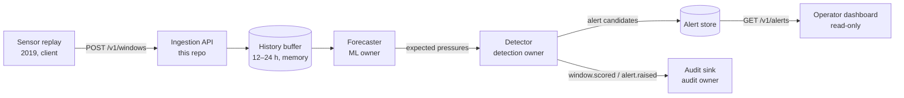

# Architecture — Backend & Ingestion

Scope of this repository: the **Ingestion API** and the **orchestration** of forecasting,
detection and audit inside CivicWater Sentinel. Source of truth for the overall system is the
team design document *CivicWater Sentinel — Solution design document* (Team CodigoMaster,
IBM Z Datathon 2026, 7 pages, not committed here). Statements below marked **[DD §n]** come
from that document; everything else is a decision of this module, recorded in `docs/adr/`.

## System context [DD §2–§4]

- Input: 5-minute SCADA windows from the simulated BattLeDIM L-Town network:
  33 pressure sensors, 3 flow sensors (two area inflows and the pump) and 1 tank level.
  Each pressure value is the mean of the previous 5 minutes.
- Training on 2018 (off-platform); 2019 replayed as a stream in timestamp order.
- Everything except training runs on IBM LinuxONE (s390x).
- The network is **simulated**. Nothing here is validated on a real network [DD §8].

## Components and ownership

| Component | Package | Owner | State |
|---|---|---|---|
| HTTP API (FastAPI) | `sentinel.api` | Backend & Ingestion | implemented, tested |
| Contracts (Pydantic) | `sentinel.schemas` | Backend & Ingestion, agreed with each owner | implemented; v1.0 `Proposed` |
| Window validation + sensor registry | `sentinel.services.ingestion`, `sentinel.sensors` | Backend & Ingestion | implemented; official IDs from `config/sensors.battledim.json` (data owner), placeholders for dev |
| History buffer | `sentinel.services.history` | Backend & Ingestion | implemented (in memory) |
| Pipeline / orchestration | `sentinel.services.pipeline` | Backend & Ingestion | implemented, tested with mocks |
| Forecaster interface + mock | `sentinel.forecasting` | interface: Backend; real models: ML owner | port + mock only |
| Detector interface, mock and `CusumDetector` | `sentinel.detection` | interface: Backend; CUSUM/localization: detection owner | port, mock and CUSUM (BE-012a..e; selected with `SENTINEL_DETECTOR=cusum`, ADR-007/008); `is_mock` unless the calibration is `battledim-2018-oof`, which does not exist yet |
| Offline calibration / evaluation tools | `sentinel.detection.offline` | detection owner | dev-only (BE-012f, needs pandas); never imported by the server |
| Audit sink interface | `sentinel.audit` | interface: Backend; hash chain: audit owner | port + null/in-memory dev sinks |
| Metrics + JSON logs | `sentinel.observability` | Backend & Ingestion | implemented (in process) |
| Narrative model, dashboard, replay of real data | other repos/owners | other members | out of scope here |

Who owns what among the team members is still to be confirmed: see `docs/dependencies.md`.

## Data flow of one window

1. `POST /v1/windows` — Pydantic validates the payload shape (types, finite values,
   unknown fields) into `SensorWindowIn`.
2. Ingestion normalises the timestamp to UTC (naive → UTC unless
   `SENTINEL_NAIVE_TIMESTAMP_TZ=reject`) and validates it against the sensor registry (missing / unexpected sensors) and
   timestamp alignment (`services/ingestion.py`).
3. Under the pipeline lock: temporal policy against the history (duplicate, conflict,
   out of order, gap) — ADR-004.
4. Window appended to the history buffer (accepted from here on).
5. If the contiguous history is shorter than `min_history_windows`: result
   `insufficient_history`, no forecast.
6. `Forecaster.predict(request)` with **past windows only** plus the current exogenous
   inputs — see `docs/integration-contracts.md` §2.
7. `Detector.evaluate(observed, expected, timestamp)` — the single long-lived detector
   instance keeps CUSUM state across windows.
8. Alert candidates become versioned `Alert` records in the alert store.
9. Audit events (`window.scored`, `alert.raised`) are sent to the audit sink.
10. A `WindowResult` is stored for idempotent replays and returned to the client.

Failure handling, idempotency and the status vocabulary: ADR-006 and
`docs/integration-contracts.md` §5.

**At startup** (`build_pipeline`): the detector comes from `SENTINEL_DETECTOR`. `mock` builds
`ThresholdMockDetector`. `cusum` calls `CusumDetector.for_pipeline` with the calibration file
(`SENTINEL_DETECTOR_CALIBRATION`), the registry's pressure sensors, the identity of the
forecaster actually served and, optionally, the region mapping (`SENTINEL_DETECTOR_REGIONS`) and
the pipe network (`SENTINEL_DETECTOR_NETWORK`, the data owner's `l-town.json`, `candidate_pipe`, ADR-011).
Any mismatch or unreadable file is a `ConfigError` before the server listens (ADR-005, ADR-008
§B). An injected detector wins over the settings. The package `sentinel.detection.offline`
(baseline residuals, replay and parameter sweep, layer-1 metrics) is development tooling: the
server never imports it.

## Non-goals of this stage

- Durable persistence (history, alerts and results are lost on restart — ADR-003).
- Asynchronous queues or distributed processing (ADR-002).
- Real forecasting, the final CUSUM calibration, hash chain or narrative (other owners).

## Concurrency model

Single process, single uvicorn worker. FastAPI runs the sync route in its thread pool;
`Pipeline` serialises steps 3–10 with one lock, so the detector sees windows strictly in
order and never concurrently. Throughput is therefore bounded by the per-window latency of
forecaster + detector (measurements: `docs/performance.md`).
